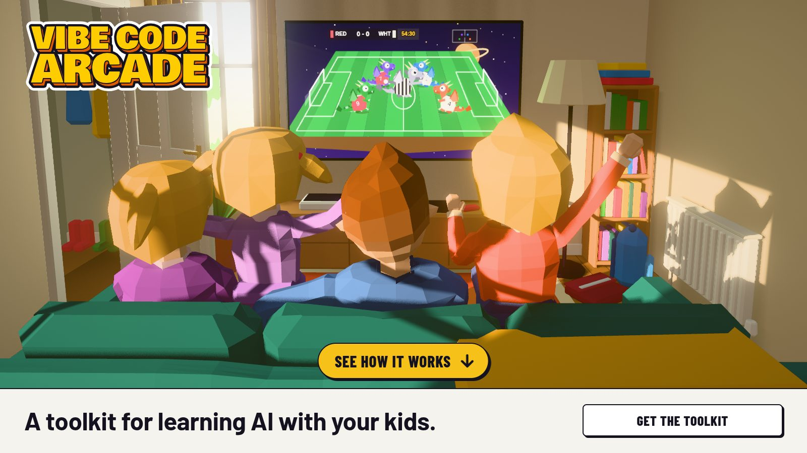

# Vibe Code Arcade: a toolkit for learning AI with your kids.

[Vibe Code Arcade](https://vibecodearcade.org) is a set of rules that allow non-technical parents to learn AI with their kids. If you've arrived to this version on github, that's probably not you! You're still welcome to have a poke around and learn more about the toolkit.

If you'd like to see the rules this repo contains in plain English, you can find them here: [vibecodearcade.org/rulebook](https://vibecodearcade.org/rulebook). Failing that, I suggest pointing your favourite AI at this URL and asking it to visualise how the process works.

## Licence

By Pete Curran. Shared under
[Creative Commons Attribution 4.0](https://creativecommons.org/licenses/by/4.0/)
(CC BY 4.0): the toolkit can be copied, modified and shared as long as you credit Vibe Code Arcade and Pete Curran and link to vibecodearcade.org. See
`LICENSE`.
